# 🍳 AI Chef – Online Learning Recipe Recommendation System

An experimental recipe recommendation system that explores **online machine learning** with **River's Bernoulli Naive Bayes**. Instead of treating the model as something that is trained once and then left unchanged, this project updates the model incrementally as new user interactions arrive.

The project extends the original **AI Chef – Smart Recipe Explorer** frontend into a full-stack machine-learning application.

> **Core idea:** `User Interaction → Predict → Learn → Update → Better Recommendations`

---

## ✨ What makes this project different?

Many introductory ML projects follow a familiar workflow:

`Dataset → Train → Model → Predict`

This project explores another workflow:

`New Interaction → Predict → Learn → Update → Predict Again`

The recommendation model receives feedback from the application and updates incrementally through River's `learn_one()` interface.

This project is intended as a learning/portfolio project demonstrating how **classical machine learning can be used in a continuously updated recommendation workflow without requiring deep learning**.

---

## 🎯 Project Goals

- Build a content-based recipe recommendation system.
- Explore online/incremental machine learning.
- Learn how user interactions can become training signals.
- Use River's `BernoulliNB` for incremental classification.
- Combine recipe metadata with user feedback.
- Return the top 5 recipe recommendations.
- Explain recommendations using simple human-readable signals.

---

## 🧠 Machine Learning Approach

### Model

The backend uses **River `BernoulliNB` (Bernoulli Naive Bayes)** as the online-learning model.

Each recipe is converted into a sparse binary feature dictionary containing features such as:

- Cuisine
- Difficulty
- Meal type
- Ingredients
- Tags

Example:

```python
{
    "cuisine=italian": True,
    "difficulty=easy": True,
    "mealtype=dinner": True,
    "ingredient=olive oil": True,
    "tag=quick": True
}
```

### Incremental learning

The model is updated using River's online-learning pattern:

```python
model.learn_one(features, liked)
```

Predictions are produced with:

```python
model.predict_proba_one(features)
```

The resulting probability is used as the recommendation score.

---

## 👤 User Feedback Signals

The application currently uses three interaction types:

| Interaction | Learning treatment |
|---|---|
| ⭐ Rating | Strongest signal; 4–5 stars are positive and 1–2 stars are negative; 3 stars are ignored |
| ❤️ Favorite | Positive learning signal |
| 👁 View | Weak signal; the model learns once every 5 views of the same recipe |

For rating strength, the implementation repeats stronger feedback more times because River's BernoulliNB interface does not use a sample-weight parameter in this project:

- 5★ / 1★ → 3 learning updates
- 4★ / 2★ → 2 learning updates
- 3★ → ignored
- Favorite → 1 learning update
- View → 1 learning update every 5 views

These are **project-level design choices**, not universal rules for recommendation systems.

---

## 🔄 Recommendation Flow

```mermaid
flowchart LR
    A[User Interaction] --> B[FastAPI API]
    B --> C[Store Interaction]
    C --> D[Feature Extraction]
    D --> E[River BernoulliNB]
    E --> F[Incremental Model Update]
    F --> G[Recommendation Request]
    G --> H[Score Candidate Recipes]
    H --> I[Top 5 Recommendations]
    I --> J[Vue Frontend]
```



---

## 🏗️ Architecture

```text
┌──────────────────────────────┐
│        Vue 3 Frontend        │
│ TypeScript + Tailwind +      │
│ Pinia + Vue Router + Vite    │
└──────────────┬───────────────┘
               │ HTTP / JSON
               ▼
┌──────────────────────────────┐
│       FastAPI Backend        │
│ Interaction API              │
│ Recommendation API           │
└──────────────┬───────────────┘
               │
               ▼
┌──────────────────────────────┐
│     Recommendation Engine    │
│                              │
│ Feature Extraction           │
│        ↓                     │
│ River BernoulliNB            │
│        ↓                     │
│ Incremental Learning         │
│        ↓                     │
│ Recommendation Ranking       │
└──────────────┬───────────────┘
               │
               ▼
┌──────────────────────────────┐
│     DummyJSON Recipes        │
│     + Local Interaction      │
│           State              │
└──────────────────────────────┘
```

---

## 🧩 Application Flow

1. The frontend loads recipes from DummyJSON.
2. The user browses, views, favorites, or rates recipes.
3. The frontend sends interaction events to the FastAPI backend.
4. The backend stores the interaction locally.
5. The recommendation engine extracts recipe features.
6. River's BernoulliNB model learns incrementally from the feedback.
7. When recommendations are requested, candidate recipes are scored.
8. Previously rated recipes are excluded.
9. The highest-scoring recipes are returned.
10. The frontend displays the top 5 recommendations.

---

## 🧊 Cold Start

When there are no user interactions yet, the system does not have enough feedback to make personalized predictions. In that situation, it returns a small random selection of recipes with a neutral score of `0.5`.

After interactions begin, the recommendation model can start using the collected feedback.

---

## 🛠️ Technology Stack

### Frontend

- Vue 3
- TypeScript
- Tailwind CSS
- Pinia
- Vue Router
- Vite

### Backend

- Python
- FastAPI
- Pydantic
- Requests

### Machine Learning

- River
- Bernoulli Naive Bayes
- Content-Based Recommendation
- Online / Incremental Learning

### Data

- DummyJSON Recipes API
- Local JSON interaction history for the single-user demo

---

## 📁 Project Structure

```text
ai-chef-online-learning-recommender/
│
├── backend/
│   ├── app/
│   │   ├── config.py
│   │   ├── feature_extraction.py
│   │   ├── main.py
│   │   ├── model.py
│   │   ├── recipes_data.py
│   │   ├── recommender.py
│   │   ├── schemas.py
│   │   └── storage.py
│   ├── data/
│   └── requirements.txt
│
├── docs/
│   └── screenshots/
│
├── src/
│   ├── components/
│   ├── composables/
│   ├── config/
│   ├── services/
│   ├── stores/
│   ├── types/
│   ├── views/
│   ├── App.vue
│   └── main.ts
│
├── .gitignore
├── package.json
├── vite.config.ts
└── README.md
```

---

## 🚀 Getting Started

### 1. Clone the repository

```bash
git clone https://github.com/navodsamarakoon/ai-chef-online-learning-recommender.git
cd ai-chef-online-learning-recommender
```

### 2. Start the backend

Create and activate a virtual environment:

**Windows PowerShell:**

```powershell
cd backend
python -m venv venv
.\venv\Scripts\Activate.ps1
```

Install dependencies:

```powershell
pip install -r requirements.txt
```

Start FastAPI:

```powershell
uvicorn app.main:app --reload --port 8000
```

The API will be available at:

```text
http://localhost:8000
```

### 3. Start the frontend

Open a second terminal:

```bash
npm install
npm run dev
```

The Vite development server normally runs at:

```text
http://localhost:5173
```

Make sure the backend is running before opening the **Recommendations** page.

---

## 🔌 API Endpoints

| Method | Endpoint | Purpose |
|---|---|---|
| POST | `/api/interactions/rating` | Record a recipe rating |
| POST | `/api/interactions/favorite` | Record favorite/unfavorite interaction |
| POST | `/api/interactions/view` | Record a recipe view |
| GET | `/api/recommendations` | Return the top recommendations |

---

## 📸 Screenshots

Screenshots can be added to `docs/screenshots/` and linked here as the project presentation is finalized.

---

## ⚠️ Current Scope & Limitations

This is a university/portfolio-scale experiment rather than a production recommendation platform.

Current limitations include:

- Single-user interaction history
- Local JSON persistence instead of a production database
- No authentication or user accounts
- Local FastAPI backend
- Small recipe dataset from DummyJSON
- The River model is rebuilt from stored interaction history when the backend starts
- No production-scale distributed streaming infrastructure

These limitations keep the system understandable while demonstrating the core online-learning concept.

---

## 🔮 Future Improvements

Possible extensions include:

- Multi-user profiles and authentication
- Database-backed interaction storage
- Larger recommendation datasets
- More sophisticated feature engineering
- Explicit and implicit feedback weighting experiments
- Model monitoring and evaluation metrics
- Concept-drift detection
- A production streaming pipeline
- Cloud deployment

---

## 📚 What I Learned

Through this project, I explored:

- Online machine learning
- Incremental model updates
- River's streaming ML workflow
- Bernoulli Naive Bayes
- Content-based recommendation
- Feature engineering for categorical/text-like recipe metadata
- Designing feedback signals
- FastAPI and frontend/backend integration
- Recommendation-system cold start
- Persisting and replaying interaction history

---

## 🍳 Related Project

This project evolved from my original frontend application:

**AI Chef – Smart Recipe Explorer**

The original project focuses on recipe discovery, search, filtering, favorites, routing and frontend application design. This repository extends that idea into an ML-powered recommendation experiment.

---

## 👨‍💻 Author

**Navod Samarakoon**  
Computer Engineering Undergraduate | AI/ML Enthusiast

GitHub: https://github.com/navodsamarakoon

---

## 📄 License

This project is intended for educational and portfolio purposes.
